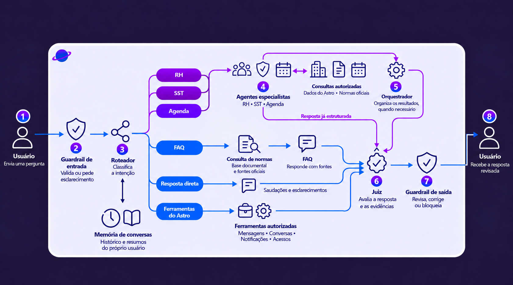

# Conferência da arquitetura multiagente

A imagem usada no README representa o fluxo principal implementado em `app/modules/chat/graph.py`. Revisão de código conferida: `944dd3f21c5dff703939ec6251b9469dd0998f07`.

## Correspondência com a implementação

| Etapa | Implementação e responsabilidade |
| --- | --- |
| Entrada | FastAPI autentica a requisição; `guardrail_entrada` valida a mensagem antes do roteamento. |
| Roteador | Classifica a intenção e seleciona o fluxo. Jev classifica; as responsabilidades que exigem texto ou argumentos estruturados permanecem separadas. |
| Memória | Histórico da sessão no MongoDB e recuperação de resumos no Qdrant, vinculados ao usuário autenticado. |
| Especialistas | Subgrafos de RH, SST e Agenda usam agentes LangChain e decisões estruturadas. A aplicação executa as ferramentas com autorização. |
| FAQ | Consulta documental e resposta com fontes. Consultas de normas também podem ocorrer pelo especialista SST. |
| Ferramentas do Astro | Consultas operacionais, conversas, notificações e acessos seguem fluxos autorizados; a decisão do modelo não concede permissões. |
| Orquestrador | Organiza a resposta quando necessário. Uma candidata já estruturada pode seguir diretamente ao Juiz. |
| Juiz e saída | O Juiz avalia candidata e evidências. O guardrail de saída aplica as verificações correspondentes antes da liberação. |

## Limites do desenho

- Agenda consulta os eventos autorizados do Astro. Não há integração com Google Calendar nesse fluxo; a imagem foi corrigida para remover essa indicação.
- A seta superior liga especialistas ao Orquestrador. A alternativa de resposta estruturada segue diretamente ao Juiz.
- O desenho resume o fluxo principal. Há saídas antecipadas com mensagens fixas da aplicação, como bloqueios e esclarecimentos, que não percorrem todos os nós.
- Nem todo nó representa uma chamada adicional ao modelo. Validações determinísticas e candidatas operacionais estruturadas evitam chamadas desnecessárias.
- O roteamento seleciona o especialista necessário; o desenho não significa execução simultânea dos três especialistas.
- Geração de PDF e montagem/persistência dos blocos são extensões do fluxo. A geração autorizada do arquivo ocorre após as validações correspondentes.

## Validação e alcance

151 testes passaram para checkpoints, memória, contexto dos guardrails, regressões do Jev, prompts e reprodução de conversas, com três avisos das dependências/execução local. A imagem também foi revisada visualmente.

Essa conferência confirma a estrutura do fluxo, não a resolução de todas as falhas funcionais observadas na homologação. Problemas de consultas, apresentação e aprovação precisam de evidências e regressões próprias. Esta atualização de documentação não altera permissões, prompts ou comportamento da API e não publica uma nova versão em produção.
